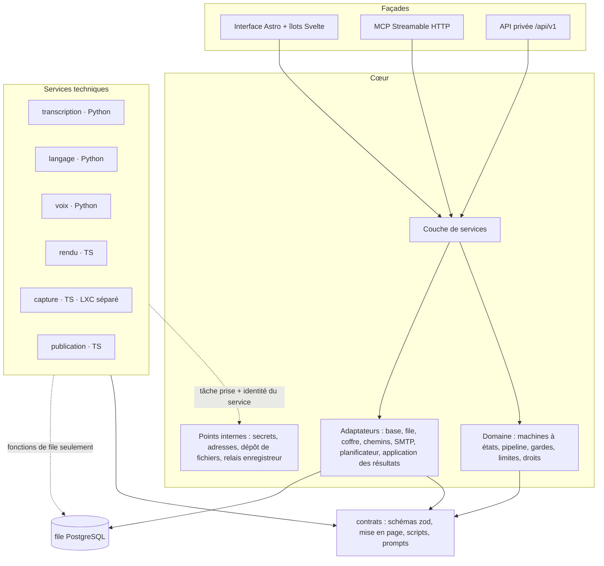
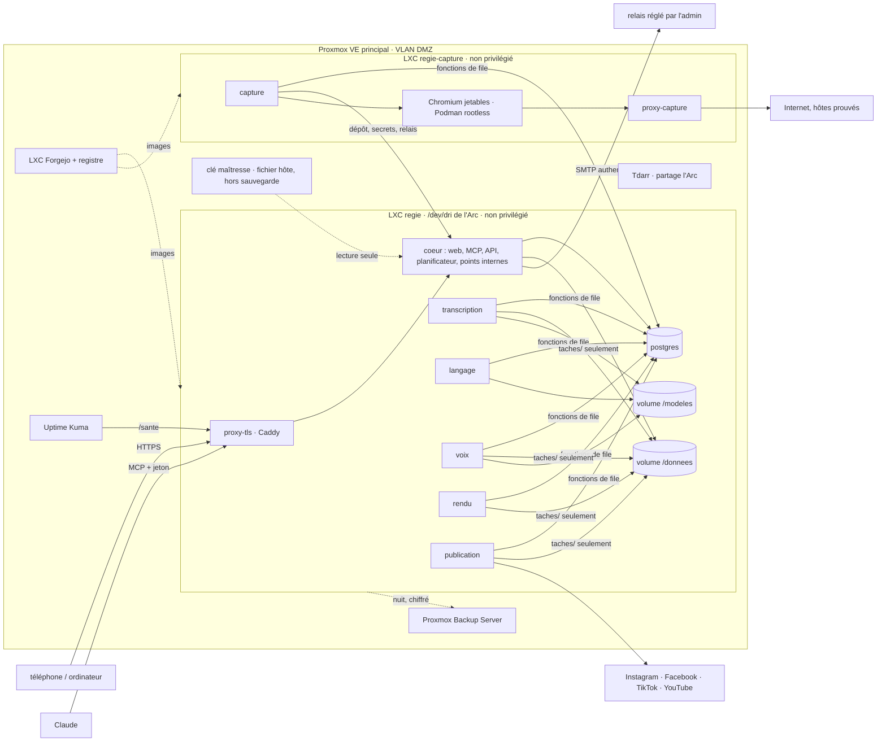
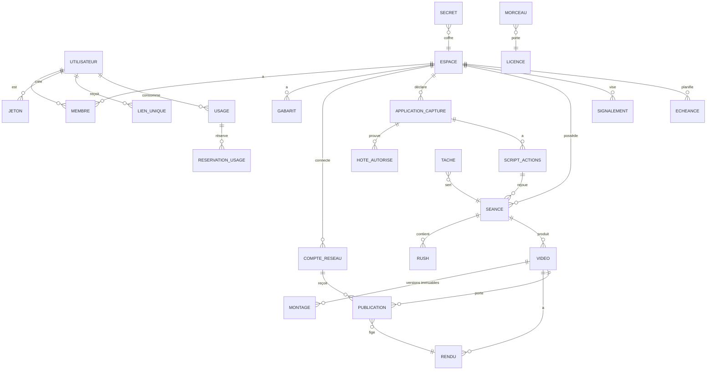

# Socle d'architecture — regie

## Paradigme

**Cœur hexagonal à trois façades, entouré de services techniques en tubes et filtres.**

- Le **cœur** porte tout le métier : règles, statuts, droits, limites, pipeline, coffre, planificateur, application des résultats. Il expose une seule couche de services, appelée par trois façades : interface (Astro), MCP, API privée.
- Les **services techniques** (transcription, langage, voix, rendu, capture, publication) sont des filtres : une tâche typée entre, un résultat typé sort. Ils ne connaissent ni utilisateur, ni espace, ni statut, et ne voient que le dossier de leur tâche.
- La **file PostgreSQL**, faite de fonctions SQL, est le seul tube entre les deux. Deux canaux internes la complètent, toujours terminés par le cœur : la remise d'un secret ou d'une adresse signée à une tâche en cours (AD-9), et le relais temps réel de l'enregistreur (AD-10).



Sens des dépendances : façades → services → domaine ; adaptateurs → contrats ; services techniques → contrats, file et points internes. Aucune flèche ne remonte. Un service technique n'importe jamais le cœur, ni un autre service technique.

## Invariants et règles

### AD-1 — Une couche de services, trois façades, une transaction par action [ADOPTED]

- **Binds :** FR-47, FR-65, NFR-28, NFR-29, toutes les actions métier.
- **Prevents :** une règle codée dans une route, un outil MCP ou un point d'API, qui donnerait trois comportements ; une action à moitié écrite (vidéo gardée sans rendu, transition sans audit).
- **Rule :**
  - Toute action métier est une fonction de `coeur/src/services`, de signature `(acteur, entrée validée) → résultat`. Elle **lève** une `ErreurMetier` en cas de refus ; elle ne renvoie jamais d'union résultat/erreur.
  - **Une fonction de service = une transaction**, dans cet ordre : `set_config('app.utilisateur_id', …, true)`, verrous, transition(s), insertions dans `taches`, `echeances` et `courriels_sortants`, audit, `pg_notify`. Les adaptateurs reçoivent la transaction ; ils n'ouvrent jamais leur propre connexion.
  - La façade MCP suit la spécification 2026-07-28 : Streamable HTTP **sans état**, montée par l'adaptateur officiel `@modelcontextprotocol/fastify` (validation de l'en-tête `Host`). Aucune action n'a besoin d'une session MCP ; le suivi des tâches se fait par interrogation de l'état (AD-12).
  - Les façades se limitent à authentifier, valider l'entrée par le schéma du contrat, appeler, puis traduire le résultat ou l'erreur. Aucun `catch` vide ; seule la façade attrape. La façade MCP rend `isError: true` avec l'`ErreurMetier` en `structuredContent` ; le test de parité compare les `ErreurMetier`, pas les enveloppes.
  - Les exceptions de FR-47 sont listées dans un seul fichier `exceptions-parite`. Y figurent, réservées à l'interface : création et révocation de jeton, gestion des membres et des droits, désactivation de la validation, connexion d'un compte réseau, suppressions de compte et d'espace, toute saisie de secret.
  - Registre unique des actions : domaine au singulier, `/api/v1/<domaine>/<verbe>` ↔ outil MCP `<domaine>_<verbe>` (ex. `/api/v1/video/garder` ↔ `video_garder`). Le test de parité vérifie la correspondance et la référence générée (FR-65).
  - Versions (NFR-29) : l'API est préfixée `/api/v1` ; chaque outil MCP porte sa version dans le registre ; la version N-1 reste servie pendant une version ; tout changement est inscrit dans `CHANGELOG-API`.

### AD-2 — Le cœur est seul propriétaire des statuts, des objets métier et de l'application des résultats

- **Binds :** statuts de vidéo, publication, séance, espace et tâche (glossaire), FR-3, FR-4, FR-19, FR-33, FR-36, FR-39, FR-44, FR-52, FR-53, FR-70.
- **Prevents :** un service technique ou deux modules du cœur qui font évoluer le même statut chacun à sa façon ; un résultat de tâche perdu au redémarrage ; une opération sur des rushes en cours de purge ; deux lectures contraires de « à qui appartient une vidéo ».
- **Rule :**
  - Les transitions de la vidéo, de la publication, de la séance et de l'espace (`actif`, `suspendu`) sont déclarées chacune dans **une** machine à états de `coeur/src/domaine`. La machine de la tâche est faite des fonctions SQL de la file (AD-3). Aucun `UPDATE` d'un statut ne se fait hors de sa machine.
  - Une transition déclenchée par une autre machine est un **événement nommé** de la machine cible (`validation_desactivee`, `montage_remplace`, `espace_suspendu`), déclaré dans celle-ci et appelé dans la même transaction.
  - **Propriété** : une séance, une vidéo et leurs fichiers appartiennent à l'**espace**. `auteur_id` est un attribut, mis à NULL à la suppression du compte. Seuls les objets des espaces dont l'utilisateur est propriétaire sont effacés avec son compte.
  - **Application des résultats** : un seul module `coeur/src/infra/application-resultats` traite toute tâche terminale dont `appliquee_le IS NULL` — au démarrage, à chaque `NOTIFY` et par balayage toutes les 30 s. Il fait avancer le pipeline (AD-21) et les machines, dans une transaction par tâche. `NOTIFY` ne sert que de réveil.
  - La machine de la séance calcule et stocke `date_purge`. Elle a un état `purge_en_cours`. Toute opération qui lit des rushes prend la séance en `FOR SHARE` et lève `SEANCE_PURGEE` si elle est purgée ou en purge ; la purge prend la séance en `FOR UPDATE`.
  - Une vidéo prête ou validée dont le montage change repasse « gardée », puis « à valider » si l'espace exige la validation (`montage_remplace`).
  - Les services techniques n'ont aucun droit sur les tables métier (AD-8).

### AD-3 — La file est un protocole SQL livré par migration

- **Binds :** FR-12, FR-31, FR-32, FR-33, FR-62, NFR-1, NFR-3, NFR-4, NFR-6, NFR-7, NFR-9, NFR-11, NFR-32.
- **Prevents :** deux implémentations de la file (TypeScript et Python) qui se comportent différemment ; une tâche prise deux fois, perdue ou relancée après un envoi au réseau ; une dictée bloquée derrière la transcription d'un autre ; deux tâches GPU qui saturent les 10 Go de l'Arc.
- **Rule :**
  - Le protocole est un ensemble de **fonctions SQL** créées par migration : `file_prendre`, `file_renouveler`, `file_terminer`, `file_echouer`, `file_point_de_non_retour`, `file_annuler`, `file_geler`. Les clients TS et Python ne font qu'appeler ces fonctions ; `paquets/contrats/file.md` n'en est que la documentation.
  - Une tâche porte : `id`, `type`, `version_contrat`, `espace_id`, `seance_id`, `utilisateur_id` (auteur imputé : équité et quota), `declenche_par`, `classe` (`interactive`, `lot`), `priorite`, `entrees` (JSON validé, sans secret ni adresse signée), `etat` (`en_attente`, `prise`, `reussie`, `echouee`, `annulee`, `gelee`), `porteur_id`, `bail_jusqu_a`, `delai_de_garde_ms`, `besoin_gpu`, `estime_ms`, `debut_le`, `fin_le`, `point_de_non_retour_le`, `resultat` ou `erreur` (`ErreurTache`, AD-4), `appliquee_le`.
  - Chaque type de tâche est déclaré dans le registre `paquets/contrats/taches.ts` (AD-21) avec son service, sa classe, `besoin_gpu`, son délai de garde et sa politique de reprise (`permise` ou `interdite`).
  - Prise : `FOR UPDATE SKIP LOCKED`, bail renouvelé, durée du bail ≥ 3 × l'intervalle de renouvellement. Un service qui ne parvient pas à renouveler arrête son travail avant l'expiration.
  - Ordre de prise : la classe `interactive` (aperçu allégé après correction, dictée, exploration) passe avant la classe `lot`, avec un ouvrier réservé par service concerné ; à l'intérieur d'une classe, l'utilisateur servi le moins récemment (NFR-4), puis la priorité, puis l'ancienneté. Une tâche interactive qui a besoin d'un modèle tourne sur processeur si le créneau GPU est pris.
  - **Sémaphore GPU** : une contrainte, l'index unique partiel `ON taches ((true)) WHERE besoin_gpu AND etat = 'prise'`. Il est atomique avec la prise et libéré par la reprise d'un bail expiré ; aucun verrou consultatif de session ne peut contredire le bail. Le sémaphore borne le calcul ; la mémoire est bornée par AD-11 (déchargement en fin de tâche). L'encodage `h264_vaapi` utilise le moteur média de l'Arc et n'est pas `besoin_gpu`.
  - **Reprise** (NFR-7) : un bail expiré remet la tâche en attente une seule fois si son type a `reprise: permise`, et aussi après une erreur « mémoire GPU insuffisante » (Tdarr). Ce n'est pas une nouvelle tentative après échec. Une tâche dont le type a `reprise: interdite` (publication), ou qui a passé son point de non-retour, passe `echouee` avec `RESULTAT_INCONNU`. Une tâche qui échoue ou dépasse son délai passe `echouee` et n'est jamais relancée automatiquement (FR-32).
  - **Point de non-retour** : un service appelle `file_point_de_non_retour(tache_id, cle)` et attend sa validation avant tout octet envoyé hors de regie. Le cœur le traduit en `envoi_en_cours` (AD-14).
  - **Estimation** (NFR-3, FR-12) : par simulation de l'ordre de prise réel (classes, équité, créneau GPU), en sommant les durées attendues des tâches qui passeront avant ; la durée attendue d'une tâche est le ratio durée/durée de rushes de son type sur ses 50 dernières tâches réussies. L'écart estimé/réel est journalisé.
  - Une suite commune vérifie les clients TS et Python, coupure de connexion et arrêt brutal du processus compris.

### AD-4 — Contrats en source unique, partagés à la compilation

- **Binds :** contrats des tâches, montage, erreurs, mise en page, scripts, prompts, MCP, API ; services Python ; FR-16, FR-32, NFR-29.
- **Prevents :** une forme de tâche, d'erreur ou de montage qui dérive entre le cœur, un service TypeScript et un service Python.
- **Rule :**
  - Les schémas vivent en zod dans `paquets/contrats`, chacun avec un numéro de version, dans le sous-ensemble de zod que `z.toJSONSchema()` exporte sans perte (pas de `transform`, `refine` limité aux contrôles exprimables en JSON Schema ; un test l'impose).
  - Les schémas envoyés au modèle de langage comme contrainte de sortie sont exportés en variante « compatible grammaire » : sans `$ref` (définitions en ligne), bornes entières, sans `uniqueItems`, `patternProperties`, `not` ni `if/then/else`, `pattern` ancré. Un test de dérive passe chacun dans le convertisseur de grammaire de llama.cpp, sans avertissement. La sortie est toujours revalidée par pydantic puis par zod.
  - Les services Python en génèrent leurs modèles pydantic par datamodel-code-generator, jamais à la main. Un test de dérive bloquant compare le JSON Schema publié aux modèles générés.
  - Un service déclare les versions de contrat qu'il lit ; `file_prendre` ne lui donne que celles-là. Un changement incompatible crée une nouvelle version ; l'ancienne reste lisible pendant une version.
  - `ErreurTache { code, etape, contexte, action_possible }`, aux codes énumérés par type de tâche. Le cœur la traduit en `ErreurMetier` sans la réinterpréter.
  - `paquets/contrats` contient aussi trois modules **purs** partagés : `mise-en-page` (AD-13), `scripts` (format déclaratif et convertisseur des tests importés, AD-10) et `prompts` (prompts versionnés, référencés par empreinte, AD-5).

### AD-5 — Le montage JSON, immuable en base, est la seule description d'une vidéo

- **Binds :** FR-6, FR-20 à FR-30, FR-36, FR-37, FR-49, FR-56 à FR-64, NFR-12.
- **Prevents :** un écran, Claude et le rendu qui lisent trois représentations différentes de la même vidéo ; deux auteurs d'un montage ; un « refaire » qui ne reproduit pas.
- **Rule :**
  - Un montage (schéma `Montage` vN) contient : recette, gabarit et versions, segments (rush, début, fin, prise), mots horodatés avec un indice de confiance **calculé par regie** (OpenVINO ne le fournit pas : probabilités des jetons si la version épinglée les expose, sinon heuristique — durée anormale, désaccord entre deux passes — ; champ optionnel tant que le banc ne l'a pas validé), textes à l'écran, musique et niveaux, zooms, couverture, variantes, zones douteuses, versions et empreintes des modèles et des prompts, et `backend` (`gpu` ou `cpu`).
  - Les montages sont des lignes **immuables** en base. Seul le cœur les crée, à partir des résultats des tâches (le service `langage` rend des propositions, pas un montage). Une correction (texte, voix, variante) produit un nouveau montage ; le précédent est conservé.
  - Le rendu est une fonction pure `(montage, fichiers source, versions épinglées) → fichier`. La tâche de rendu reçoit le montage en valeur.
  - Reproductibilité (FR-30, NFR-12) : modèles de langage à température 0, graine fixe, sortie contrainte par schéma JSON ; `llama-server` lancé avec `--parallel 1`, sans `cache_prompt` ni traitement continu par lots. La promesse est « même sortie à matériel, pilote, backend et build identiques », tous inscrits dans le montage et `modeles.lock` ; un « refaire » garde ces versions ou signale qu'elles ont changé.
  - Toute police de gabarit et tout morceau de musique portent en base leur licence, leur source et leur attribution ; un élément sans licence connue ne peut pas être ajouté.

### AD-6 — Gardes : un seul module de verdict, non forçable

- **Binds :** FR-7, FR-28, FR-42, NFR-27.
- **Prevents :** une garde appliquée à un endroit et oubliée à un autre, ou contournable par un paramètre ; une garde de contraste qui ne voit pas l'image.
- **Rule :**
  - `coeur/src/domaine/gardes` est une fonction pure `(montage, mesures, bornes du réseau) → violations[]`. Chaque violation porte le segment, le code temporel, la mesure et le seuil.
  - Les gardes statiques (durées, zones, tailles) se calculent sur le montage. Les gardes visuelles (contraste du texte sur l'image, niveaux sonores) utilisent des **mesures** produites par la tâche `analyse_media` du service `rendu` ; le verdict reste rendu par le même module.
  - Elle est appelée avant tout rendu complet, avant « garder », avant la création d'une publication et à l'aperçu du gabarit. Une violation lève `GARDE_NON_RESPECTEE` (HTTP 422).
  - Les seuils et les bornes par réseau vivent dans `deploiement/bornes.json`, versionné et testé.
  - Aucune signature de service, aucun outil ni aucun point d'API n'a de paramètre qui saute une garde.

### AD-7 — Fichiers : chemins attribués par le cœur, services confinés à leur tâche

- **Binds :** FR-6, FR-10, FR-18, FR-40, FR-49, FR-52, FR-53, FR-62, FR-68, NFR-18, NFR-19.
- **Prevents :** une tâche qui lit les fichiers d'un autre espace ; un chemin construit à partir d'une saisie ; un lien symbolique qui fait servir le fichier d'un autre ; une vidéo servie sans signature ; une purge qui rend une vidéo gardée impubliable.
- **Rule :**
  - Arborescence fixe, construite par un **seul** module `coeur/src/infra/chemins`, sous une racine configurable `RACINE_DONNEES` :
    - `espaces/<espace_id>/seances/<seance_id>/{rushes,transcriptions,captures,voix}` ;
    - `espaces/<espace_id>/videos/<video_id>/{allegees,rendus}` (les montages sont en base) ;
    - `espaces/<espace_id>/gabarits/` ; `musique/` ; `utilisateurs/<utilisateur_id>/exports/` ;
    - `envois/` (envois tus en cours, effacés après 24 h) ;
    - `taches/<tache_id>/{entrees,sortie}/`.
  - **Seul le cœur monte la racine entière.** Un service technique ne monte que `taches/`, et ne lit que les chemins relatifs reçus dans sa tâche. Le cœur prépare `entrees/` par liens physiques et efface le dossier à la fin de la tâche (ou par échéance après plantage).
  - Le cœur relit `sortie/` avec `O_NOFOLLOW` et `lstat` ; il refuse liens symboliques, liens physiques et tout chemin hors de `sortie/`, puis déplace le résultat à sa place définitive.
  - Fichiers reçus : le cœur vérifie la signature magique, puis la tâche `analyse_media` (service `rendu`, conteneur sans réseau, limites CPU/mémoire/temps) sonde le fichier avec ffprobe ; le cœur ne lance jamais ffprobe ni ffmpeg sur une entrée d'utilisateur. Les SVG de gabarit sont rastérisés à l'import.
  - **Adresses signées** : fabriquées juste à temps par le cœur, jamais écrites dans la file, la base ou un journal. Le HMAC (sous-clé `hmac-adresses`, avec `kid`) couvre méthode, chemin canonique, expiration (< 1 h), objet, usage (`publication` ou `session`) et identifiant de liaison ; comparaison à temps constant. Usage `session` : la session est revérifiée à la lecture. Usage `publication` : révoquée dès la publication confirmée. Réponses avec `Referrer-Policy: no-referrer`, `Cache-Control: private, no-store`, `nosniff`, `Content-Type` fixé par le cœur ; le journal de `proxy-tls` tronque la chaîne de requête.
  - Fichiers d'utilisateurs servis depuis un domaine distinct sans cookie (`fichiers.<domaine>`), avec `Content-Security-Policy: sandbox; default-src 'none'` et `Content-Disposition` adapté.
  - **Purge** (FR-52) : elle ne supprime que rushes, transcriptions, captures et versions allégées, et seulement si chaque vidéo gardée a un rendu complet du montage en vigueur et qu'aucune tâche de la séance n'est en vol. Sinon elle est reportée et l'administrateur alerté. Un rendu figé par une publication n'est jamais purgé.
  - Copie des données (FR-68) : la tâche interne `export_donnees` produit une archive dans `exports/`, servie par adresse signée de session, effacée à expiration. Périmètre : contenus créés par l'utilisateur et métadonnées de ses espaces, jamais les données d'autres membres.
  - Suppression (FR-52, FR-53) : la base d'abord, les dossiers ensuite ; l'identifiant opaque est inscrit dans `suppressions` (AD-16).

### AD-8 — Cloisonnement : acteur obligatoire, RLS forcée, un rôle par service

- **Binds :** FR-1, FR-3, FR-5, FR-46, FR-66, FR-69, FR-70, NFR-16, NFR-21.
- **Prevents :** une requête qui oublie son filtre d'espace ; un membre retiré qui garde l'accès ; un administrateur qui voit le contenu ; un service compromis qui lit ou forge les tâches des autres ; un planificateur à qui la RLS cache tout.
- **Rule :**
  - Toute fonction de service reçoit un `Acteur` (`utilisateurId`, espaces et droits, origine `interface|mcp|api|systeme`, `jetonId`), **recalculé depuis la base à chaque requête**, jamais mis en cache dans la session ou le jeton.
  - `Acteur.systeme(motif, objet)` sert au planificateur et à l'application des résultats : il fixe `app.utilisateur_id` au propriétaire de l'objet et l'origine `systeme`. Aucun code applicatif ne tourne sous `regie_migrations` ni avec `BYPASSRLS`.
  - La construction de l'acteur refuse un espace `suspendu` sur les trois façades ; les tâches, publications et échéances d'un espace suspendu sont gelées. Un acteur au courriel non confirmé ne peut créer ni espace ni séance.
  - RLS : seul `regie_migrations` possède les tables ; `ENABLE` et `FORCE ROW LEVEL SECURITY` sur toute table liée à un espace ou à un utilisateur ; `select set_config('app.utilisateur_id', $1, true)` en tête de chaque transaction, et des règles écrites avec `current_setting('app.utilisateur_id', true)::uuid` (variable absente = aucune ligne, échec fermé ; un test le vérifie hors transaction) ; un pool de connexions par rôle, jamais de `SET ROLE`.
  - Rôles PostgreSQL, créés par migration :
    - `regie_coeur` : soumis à la RLS ;
    - `regie_admin` : instance, métadonnées des espaces, signalements, catalogue musical ; **aucun SELECT** sur rushes, montages, vidéos, transcriptions et publications ;
    - `regie_migrations` : DDL ;
    - **un rôle par service technique** (`regie_svc_rendu`, `regie_svc_capture`…) : `EXECUTE` sur les seules fonctions de file, qui ne lui rendent que ses types de tâche et ne le laissent terminer que les tâches dont il porte le bail. Aucun accès direct aux tables.
  - La table `taches` est hors RLS : elle n'est atteinte que par ses fonctions et par le cœur.
  - La suite de NFR-16 tourne avec deux comptes sur chaque façade, et avec deux services sur la file.

### AD-9 — Secrets : coffre dans le cœur, remise liée à la tâche et au service

- **Binds :** FR-13, FR-41, FR-47, FR-71, NFR-13, NFR-14, NFR-15.
- **Prevents :** un secret en clair dans la file, un journal, une sauvegarde ou une réponse ; une clé maîtresse sauvegardée avec ce qu'elle protège ; un service qui vole le secret d'un autre ; un chiffré déplacé d'un espace à un autre.
- **Rule :**
  - **Clé maîtresse** : un fichier sur l'hôte PVE, monté en lecture seule dans le seul conteneur `coeur` (secret Podman en tmpfs), **exclu** de PBS et du dump. Copie hors ligne sous séquestre (papier ou clé USB), documentée. Sans clé valide, le cœur refuse de démarrer en nommant la cause.
  - Sous-clés dérivées par HKDF : `coffre`, `hmac-adresses`, `liens`. Une rotation rechiffre tous les secrets.
  - Coffre en AES-256-GCM, au format versionné ; l'AAD contient `secret_id ‖ espace_id ‖ type`.
  - Aucun secret ni ticket dans la file. Un service obtient un secret par `POST /interne/secrets/lire`, accepté seulement si : l'identité du service est prouvée (jeton de service propre à chaque conteneur, réseau interne), la tâche est `prise` avec le `porteur_id` de son bail, et le couple (type de tâche, type de secret) figure dans une matrice déclarée. Le secret vit en mémoire le temps de l'action.
  - `POST /interne/secrets/deposer`, aux mêmes conditions, est réservé au service `publication` pour rendre un jeton OAuth renouvelé ; le cœur le range et met à jour `expire_le` du compte réseau.
  - Aucun outil MCP ni point d'API ne lit, n'écrit ni ne renvoie un secret. Clés, OAuth, mot de passe du relais SMTP et identifiants de démo ne se saisissent que dans l'interface.
  - Journaux : masquage par nom de clé **et par valeur** (ensemble des secrets déchiffrés en cours, motifs `access_token=`, `Bearer `, `client_secret`) ; erreurs des réseaux normalisées avant journalisation ; `pg` ne journalise pas les paramètres.

### AD-10 — Capture isolée dans un LXC séparé, scripts déclaratifs

- **Binds :** FR-13 à FR-19, NFR-19.
- **Prevents :** un script d'inscrit qui atteint le réseau du foyer, les fichiers d'un autre, la clé maîtresse ou un secret étranger ; un identifiant de démo exfiltré ; une page hostile qui pilote Claude.
- **Rule :**
  - Le service `capture`, le `proxy-capture` et les conteneurs Chromium tournent dans un **LXC `regie-capture` séparé**, non privilégié, sur un VLAN isolé dont les seules sorties sont : Internet via `proxy-capture`, et vers le LXC `regie` le port PostgreSQL (fonctions de file) et les points internes du cœur. Il ne monte ni `/donnees` ni `/modeles` ; il rend ses fichiers par `POST /interne/depot/<tache_id>`.
  - Les conteneurs jetables sont lancés par une instance Podman rootless d'un **utilisateur Unix dédié**, avec son propre socket : le service `capture` n'a accès qu'à ce socket, qui ne voit aucun autre conteneur (un test le vérifie). Un conteneur par capture, exploration ou séance d'enregistrement : `cap-drop=ALL`, `no-new-privileges`, seccomp par défaut, racine en lecture seule, limites de processus, mémoire et durée, ni `/dev/dri` ni volume partagé. Le bac à sable de Chromium reste actif (jamais `--no-sandbox`), ce qu'un test vérifie à l'installation.
  - Réseau : chaque conteneur est sur un réseau `internal` sans DNS ni passerelle, qui ne mène qu'au proxy. Chromium : `--host-resolver-rules` vers le proxy, WebRTC `disable_non_proxied_udp`, QUIC et DoH coupés, téléchargements refusés.
  - Le proxy résout lui-même chaque nom, valide **chaque** IP résolue et se connecte à l'IP validée (anti-DNS rebinding). Sont refusées : adresses privées, de bouclage, de lien local, CGNAT `100.64/10`, ULA IPv6, IPv4 mappées en IPv6, et l'IP publique du foyer. Il trace chaque destination, conservée 1 an.
  - Hôtes autorisés : déclarés par l'espace et prouvés par une **preuve de contrôle du domaine** (DNS TXT ou `/.well-known/regie`), revalidés à chaque connexion. Exception : une liste « hôte + IP privée précise » réglée par l'administrateur seul, réservée à ses propres espaces (ex. Établia sur le réseau local).
  - **Scripts déclaratifs** : un script est une liste d'étapes JSON (`aller`, `cliquer`, `saisir`, `attendre`, `connexion`, `filmer`) définie dans `paquets/contrats/scripts`. Un test Playwright ou Cypress importé est **converti** par ce module pur à l'import, jamais exécuté. Les identifiants de démo ne sont utilisables que par l'unique étape `connexion`, déclarée par le propriétaire de l'espace, et ne sont jamais tapés ailleurs ni enregistrés dans un script.
  - Trois modes :
    - **capture** : joue un script et filme ;
    - **exploration** (FR-14) : rend une carte des pages, des éléments cliquables et des captures d'écran ; tout texte issu d'une page est rendu à Claude dans des champs marqués `non_fiable` ;
    - **enregistreur** : l'écran est relayé par `page.screencast` (Playwright, image Chromium épinglée sur la même version que `playwright`) sur un **WebSocket terminé par le cœur** (session de l'utilisateur), relayé vers le conteneur par un ticket lié à la séance d'enregistrement ; les clics et saisies deviennent des étapes, les saisies de mot de passe sont remplacées par l'étape `connexion`.
  - Rejeu (FR-19, UJ-3) : un rejeu crée une séance de capture liée au script, puis émet `montage_remplace` sur la vidéo liée (AD-2). Le jeton de rejeu ne permet que `scripts_rejouer` sur des scripts existants (AD-15).

### AD-11 — IA locale derrière les contrats, modèles épinglés

- **Binds :** FR-14, FR-20 à FR-27, FR-59, FR-60, FR-62, NFR-2, NFR-26, NFR-30, NFR-38.
- **Prevents :** un appel à une IA en nuage ; un changement de modèle silencieux ; un modèle dans une image et un autre sur le volume, dont un seul est vérifié.
- **Rule :**
  - Transcription, langage et voix sont trois services Python sur le réseau interne sans sortie (AD-17).
  - La transcription utilise OpenVINO GenAI (`ASRPipeline` ou `WhisperPipeline`, construit avec `word_timestamps=True`) avec Whisper large-v3-turbo, pour des horodatages au mot natifs sur l'Arc.
  - **VRAM** : chaque service GPU libère sa mémoire à la fin de chaque tâche (déchargement du modèle par le mode routeur de `llama-server`, destruction du pipeline OpenVINO). Le temps de rechargement est compté dans l'estimation.
  - Le service de langage expose une API compatible OpenAI, adossée à llama.cpp, avec des sorties contraintes par schéma JSON. Les légendes et hashtags qu'il propose ne sont jamais publiés sans relecture ou état « à valider ».
  - Les modèles et les voix ne sont **que** sur le volume `/modeles`, jamais dans une image. `deploiement/modeles.lock` (nom, version, licence, SHA-256) en est l'unique liste, lue au démarrage (refus si une empreinte manque, NFR-30) et par la suite licences.
  - Seuls des modèles et des voix sous licence libre autorisant l'usage commercial y entrent. Un composant sous GPL (moteur de voix) reste dans son conteneur, appelé par la file, jamais lié au code du cœur.
  - L'accélération par l'Arc est un réglage de déploiement : chaque service tourne aussi sur processeur, et le backend utilisé est inscrit dans le montage.

### AD-12 — Le cœur ne fait jamais de travail long dans une requête

- **Binds :** FR-10, FR-11, FR-12, FR-31, NFR-1, NFR-3.
- **Prevents :** une page, une réponse MCP ou une réponse d'API bloquée ; un flux temps réel qui fuit après le retrait d'un membre ; une requête forgée depuis un autre site.
- **Rule :**
  - Toute opération de plus de 500 ms passe par une tâche. La façade rend aussitôt `{ tacheId, etat }` (HTTP 202) ; l'état est interrogeable (position, étape, temps estimé).
  - Les îlots Svelte appellent des routes `/i/…` **sous session seulement** ; `/api/v1` et `/mcp` n'acceptent qu'un jeton `Bearer` et jamais de cookie. Les routes `/i/` à effet vérifient `Origin` et un jeton anti-CSRF ; cookie de session `__Host-`.
  - L'interface suit l'avancement par **SSE** (un flux par utilisateur). `pg_notify` ne porte que `{ type, objet_id }` (bien sous la limite de 8 000 octets) et s'écoute sur une connexion dédiée, hors pool ; le flux relit l'objet par la couche de services avec l'acteur recalculé, à chaque événement et toutes les 30 s, et se ferme sur 401 ou 403. MCP et API interrogent l'état.
  - Envois par tus dans `envois/` (`respectForwardedHeaders`, `maxSize`, expiration du `file-store` pour l'effacement à 24 h) : un crochet vérifie à chaque requête que l'envoi appartient à l'acteur et à la séance ; identifiants d'envoi aléatoires ; `Upload-Length` obligatoire (`Upload-Defer-Length` refusé dans `onUploadCreate`) et revérifié à chaque `PATCH` ; nombre d'envois ouverts borné par utilisateur ; nouveaux envois refusés sous 15 % d'espace disque libre ; métadonnées jamais utilisées pour un chemin ou un `Content-Type`. La fin d'un envoi crée la tâche `analyse_media`.

### AD-13 — Aperçu dans le navigateur, une seule mise en page, rendu faisant foi

- **Binds :** FR-34, FR-36, FR-37, FR-52, FR-61, FR-62, NFR-5, NFR-6, NFR-33.
- **Prevents :** une correction qui attend un rendu complet ; un aperçu qui ne ressemble pas au fichier publié ; un rendu complet relancé à chaque frappe.
- **Rule :**
  - Le module pur `paquets/contrats/mise-en-page` calcule, depuis le montage, le gabarit et `bornes.json`, des boîtes positionnées (lignes, coupures, mots, instants). Le lecteur du navigateur et le générateur ASS ne font que dessiner ces boîtes. Un test compare une image du rendu allégé à une capture du lecteur.
  - Le lecteur du fil joue la version allégée la plus récente. Il applique le dernier montage (sauts de coupes, textes) jusqu'à ce que la nouvelle version allégée, rendue en classe `interactive`, la remplace.
  - L'export et la publication utilisent toujours le rendu complet du montage en vigueur, contrôlé par les gardes. Pour une vidéo gardée, ce rendu est lancé 10 min après la dernière correction (échéance `rendu_complet`), ou immédiatement à la demande d'export, de publication ou de purge.

### AD-14 — Échéances, programmation et publication sans double envoi

- **Binds :** FR-4, FR-41 à FR-44, FR-52, FR-53, FR-63, NFR-8, NFR-9, NFR-25.
- **Prevents :** une publication envoyée deux fois, partie à la mauvaise heure, ou partie avec un montage que personne n'a validé ; une échéance oubliée ou orpheline ; un courriel perdu ou envoyé deux fois.
- **Rule :**
  - Tout instant est stocké en UTC (`timestamptz`) ; l'heure de Paris n'existe qu'à l'affichage et à la saisie. [ADOPTED]
  - Table `echeances` (`type`, `objet_id`, `espace_id`, `echeance_le`, `etat` : `active`, `gelee`, `consommee`, `annulee`) : publication programmée, rendu complet différé, purge et rappel J+30, expiration des envois tus, des liens uniques, des exports et des dossiers de tâche, rappels de connexion réseau (J-7 et la veille), suppression annoncée d'un espace partagé. La suppression d'un objet annule ses échéances dans la même transaction ; la suspension d'un espace les gèle ; un gestionnaire qui ne trouve plus son objet consigne `annulee`, sans erreur.
  - Le planificateur se réveille sur la prochaine échéance et recalcule après chaque écriture. Au démarrage, il rattrape les échéances manquées depuis moins de 2 h ; les autres passent en échec avec leur cause. [ADOPTED]
  - Une publication fige `montage_id` et `rendu_id` à sa création. Si le montage de la vidéo change, ses publications `programmee` passent `en_attente_confirmation` et ne partent pas ; sans confirmation, elles passent `en_echec` avec `MONTAGE_MODIFIE`.
  - Chaque publication porte une clé d'idempotence. Sa tâche a `reprise: interdite` ; le service appelle `file_point_de_non_retour` avant le premier octet envoyé, et le cœur passe la publication `envoi_en_cours`. Une publication trouvée `envoi_en_cours` sans résultat n'est jamais renvoyée : elle est vérifiée auprès du réseau quand c'est possible, sinon elle passe en échec `RESULTAT_INCONNU`.
  - Envoi du fichier : téléversement depuis `publication` partout où l'API le permet ; sinon adresse signée d'usage `publication` demandée juste à temps au cœur (AD-7).
  - « Envoyée en brouillon » (TikTok, FR-63) est un état final, sans vérification ultérieure. Les niveaux de confidentialité permis par un compte sont lus par une tâche et mis en cache. Le mode privé forcé par réseau est un réglage d'instance, imposé par le connecteur.
  - OAuth : `state` aléatoire lié à la session et à l'`espace_id`, à usage unique, 10 min ; PKCE quand le réseau le permet ; `redirect_uri` fixe construite depuis `URL_PUBLIQUE` ; callback sous session, réservé au propriétaire avec droit de publication ; portées minimales par réseau, figées dans `deploiement/reseaux.json` et testées.
  - Chaque réseau a son connecteur isolé dans le service `publication`, derrière une interface commune.
  - **Courriels** : table `courriels_sortants` (outbox) écrite dans la transaction de l'événement, envoyée par un ouvrier interne au cœur en SMTP authentifié vers le relais de l'administrateur, avec une clé d'idempotence et au plus 3 essais (exception explicite à FR-32, qui ne vise que les étapes de traitement). Liens construits depuis `URL_PUBLIQUE`, jamais depuis l'en-tête `Host` ; champs d'utilisateur placés dans un en-tête débarrassés de CR/LF et encodés ; invitations limitées par espace et par jour.

### AD-15 — Identité, sessions, jetons, liens, audit

- **Binds :** FR-1, FR-3, FR-19, FR-46, FR-51, FR-53, FR-54, FR-66, FR-69, FR-70, FR-71, NFR-17, NFR-20, NFR-21.
- **Prevents :** une session impossible à révoquer ; un jeton trop large ou éternel ; un mot de passe deviné par essais ; un tiers qui verrouille un compte ; une action non tracée ou un audit altérable ; un audit qui empêche de supprimer un compte.
- **Rule :**
  - Mots de passe hachés par scrypt (`N=2^17, r=8, p=1` ou équivalent mesuré à plus de 100 ms), paramètres stockés avec le hachage, longueur plafonnée. [ADOPTED]
  - Freinage (NFR-20) : compteurs d'échecs en base, fenêtre glissante de 15 min. Le couple (compte, IP) est bloqué temporairement après 5 échecs ; le compte seul n'a qu'un freinage progressif, sans blocage dur, et son titulaire est prévenu. Entrée d'audit à chaque blocage.
  - L'inscription répond toujours « vérifie ta boîte » ; un courriel « tu as déjà un compte » part si l'adresse existe.
  - Sessions en base : identifiant opaque dans un cookie `__Host-` `HttpOnly; SameSite=Lax; Secure`, révoquées au changement de mot de passe, au blocage et à la suppression du compte. Sessions d'administration de 12 h au plus.
  - Second facteur (TOTP ou WebAuthn) **obligatoire** pour l'administrateur, proposé aux propriétaires ayant le droit de publication. Réauthentification de moins de 10 min pour saisir une clé, accorder le droit de publication, connecter un compte réseau ou créer un jeton.
  - **Connexion de Claude (MCP)** : le cœur est serveur d'autorisation OAuth 2.1 et la façade MCP serveur de ressources (spéc. MCP 2026-07-28) : métadonnées publiées, PKCE S256 obligatoire, inscription des clients (CIMD, et DCR bornée par débit), écran de consentement sous session qui montre les portées et l'espace, `iss` dans la réponse (RFC 9207), jetons d'accès courts liés à l'audience `/mcp`, jetons de rafraîchissement tournants et révocables depuis l'interface. Les autorisations accordées figurent avec les jetons.
  - Jetons d'API et de rejeu (et MCP pour Claude Code, qui accepte un en-tête) : préfixe `regie_pat_`, stockés hachés, affichés une seule fois, expiration obligatoire (90 j, 1 an pour un jeton de rejeu), `dernier_usage_le` affiché, limite de débit par jeton et par IP. Portées **énumérées** et minimales par défaut ; portée effective = droits de l'utilisateur ∩ espace(s) ∩ portées.
  - Liens à usage unique (confirmation, réinitialisation 1 h, invitation 7 j) : 256 bits aléatoires, stockés hachés avec type et expiration, comparés à temps constant, consommés dans une transaction, invalidés par un nouveau lien du même type.
  - Le compte garde la version des pages légales acceptée et sa date (FR-51).
  - Routes publiques énumérées dans un seul fichier, comparé aux routes servies par un test : connexion, inscription, confirmation, réinitialisation, acceptation d'invitation, point de contact des signalements (débit et taille bornés, sans copie automatique), pages légales, adresses signées, `/sante`, et les points OAuth (métadonnées, inscription des clients, jeton ; l'autorisation elle-même exige une session). [ADOPTED]
  - **Audit** : `regie_coeur` n'a que `INSERT` sur la table, la lit par une vue soumise à la RLS (soi-même, propriétaire de l'espace, administrateur pour les entrées d'instance). Chaque entrée porte `utilisateur_id` et `espace_id` **opaques, sans clé étrangère**, `action` (code stable), origine (`interface|mcp|api|systeme`, avec `motif` pour `systeme`), jeton et objet, jamais de secret ni de donnée nominative ; IP tronquée après 30 jours. Un chaînage `empreinte = sha256(precedente ‖ ligne)` rend toute altération détectable ; l'empreinte de tête est exportée chaque nuit hors du LXC. Toute écriture d'une fonction de service passe par lui.

### AD-16 — Exploitation : deux LXC, conteneurs épinglés, sauvegardes sans la clé

- **Binds :** NFR-7, NFR-13, NFR-30, NFR-31, NFR-34, FR-53, FR-67.
- **Prevents :** une carte graphique rendue exclusive à une VM ; un environnement qui dérive des images testées ; une mise à jour qui perd la file ; une sauvegarde qui livre le coffre et sa clé ; une restauration qui publie ou ressuscite un compte supprimé.
- **Rule :**
  - Sur le PVE principal :
    - LXC **`regie`**, non privilégié, nesting activé pour Podman, `/dev/dri` de l'Arc partagé (Tdarr garde son accès ; pas de VM avec passage PCI, la B570 n'a pas de SR-IOV) : `proxy-tls`, `coeur`, `postgres`, `transcription`, `langage`, `voix`, `rendu`, `publication` ;
    - LXC **`regie-capture`** (AD-10).
  - Les deux LXC sont sur un VLAN DMZ, avec refus par défaut vers le réseau local.
  - Tdarr est réglé pour encoder en heures creuses ; ce partage est un risque accepté et documenté.
  - Les LXC sont en Debian 13, avec Podman 5.4 rootless ; les conteneurs sont déclarés en unités **Quadlet** (systemd, `loginctl enable-linger`), qui les relancent au démarrage de l'hôte (NFR-7), avec cgroups v2 et réseaux netavark `--internal`. Les plages `lxc.idmap` et `/etc/subuid` sont élargies, et `/dev/dri` est transmis avec le `gid` du groupe `render` (`--group-add keep-groups`). Images épinglées par empreinte, construites par la CI (AD-19). ffmpeg, llama.cpp et OpenVINO sont dans les images ; les modèles sur `/modeles` (AD-11).
  - Migrations SQL numérotées, en avant seulement et compatibles avec la version N-1 du code, appliquées au démarrage du cœur dans une transaction, avant l'ouverture de la file. `migrations_appliquees` garde le SHA-256 de chaque fichier ; le cœur refuse de démarrer si une migration appliquée a changé. [ADOPTED] Chaque service attend que la version minimale de schéma déclarée dans son image soit appliquée.
  - Ordre de démarrage du cœur : environnement → clé et coffre → base → migrations → services → façades → Astro → application des résultats, file et planificateur.
  - **Sauvegardes**, chaque nuit : dump PostgreSQL cohérent chiffré par age, puis PBS (chiffrement côté client) pour les deux LXC et le volume, avec une copie hors site. Périmètre : base, rendus, gabarits, musique, exports en cours ; **les rushes sont exclus** (éphémères, perte assumée et dite dans la politique de confidentialité). La clé maîtresse n'est jamais dans une sauvegarde (AD-9). Rétention 35 jours.
  - **Restauration** : mode `restauration` sans planificateur, sans publication ni courriel ; la table `suppressions` (ajout seul) est rejouée avant toute réouverture. Une restauration test a lieu chaque mois dans un conteneur jetable.
  - Chaque page affiche le lien vers le code source de l'empreinte en service (AGPL-3.0). Une procédure de mise à jour d'urgence de sécurité est documentée dans `deploiement/`.

### AD-17 — Sorties réseau et licences contrôlées

- **Binds :** NFR-26, NFR-35, FR-49, FR-67.
- **Prevents :** un appel sortant non déclaré (traceur, IA en nuage, police distante) ; une dépendance dont la licence interdit l'usage prévu ; un paquet qui exécute du code à l'installation.
- **Rule :**
  - Sorties vers Internet autorisées : `publication` (réseaux sociaux), `proxy-capture` (hôtes autorisés), `coeur` (relais SMTP réglé par l'administrateur seulement), `proxy-tls` (ACME). Tous les autres conteneurs sont sur un réseau interne sans sortie.
  - CSP `default-src 'self'` sur toutes les pages, produite par l'option `security.csp` d'Astro (empreintes des scripts d'hydratation des îlots) ; aucune ressource tierce (police, script, mesure d'audience). `security.allowedDomains` limite l'en-tête `X-Forwarded-Host` accepté derrière `proxy-tls`.
  - Une suite « appels sortants » compare les connexions observées à une liste autorisée versionnée.
  - Une suite « licences », bloquante à chaque commit, contrôle les dépendances npm et pip, `modeles.lock`, les polices et le catalogue musical ; les licences tierces sont regroupées dans `LICENCES-TIERS`.
  - Dépendances installées depuis des verrous à empreintes : `npm ci --ignore-scripts` (exceptions listées), `pip install --require-hashes`.

### AD-18 — Limites : un module, des valeurs réglables, des réservations

- **Binds :** FR-1, FR-6, FR-9, FR-20, FR-41, FR-42.
- **Prevents :** une limite vérifiée à un endroit et oubliée à un autre ; deux envois parallèles qui passent chacun sous le quota ; un envoi de 20 Go accepté puis refusé après transfert.
- **Rule :**
  - Toutes les limites vivent dans `coeur/src/domaine/limites`, avec leurs valeurs en réglages d'instance : 2 h de rushes par mois civil (heure de Paris), 20 Go stockés, 30 min par séance, 5 brouillons par séance, 3 gabarits par espace.
  - Contrôle par **réservation** : la création d'un envoi tus insère une ligne `reservations_usage` sous `SELECT … FOR UPDATE` de la ligne `usages` de l'auteur, sur la taille annoncée (refus avant transfert). L'analyse à réception transforme la réservation en consommation sur la durée mesurée ; une expiration la libère.
  - Les compteurs sont imputés à l'auteur de la séance ; les objets appartiennent à l'espace (AD-2). « Refaire » ne consomme pas de quota.
  - Unicités en contraintes de base : un compte par réseau par espace, une publication par compte et par vidéo.

### AD-19 — Environnements et chaîne de livraison

- **Binds :** NFR-2, NFR-13, NFR-29, NFR-30, NFR-31, toutes les suites bloquantes.
- **Prevents :** une suite « bloquante » que rien ne fait tourner ; une image de production construite à la main ; une version plus lente livrée sans le voir ; un environnement de dev qui exige l'Arc.
- **Rule :**
  - **dev** (Mac) : les mêmes conteneurs, lancés par un fichier compose de développement avec un profil `cpu` (petits modèles déclarés dans `modeles.lock`, sans `/dev/dri`) ; données de démonstration ; aucun secret réel.
  - **ci** : Forgejo et Forgejo Actions dans un LXC dédié, avec son registre d'images. Chaque commit lance toutes les suites bloquantes ; une fusion sur `main` construit les images, les étiquette par empreinte et publie les SBOM. Le dépôt GitHub n'est qu'un miroir.
  - **recette** : un LXC `regie-recette` sur l'Arc, démarré à la demande, qui joue sur le jeu de rushes de référence le chronométrage (une version qui dépasse les seuils de NFR-2 est refusée), les tests de charge et la restauration mensuelle. Il ne tourne jamais en même temps qu'une tâche GPU de production.
  - **prod** : AD-16. Une livraison est une mise à jour des empreintes dans les fichiers compose. Retour arrière = empreintes précédentes, possible puisque les migrations sont compatibles N-1.

### AD-20 — Exposition et supervision

- **Binds :** NFR-13, NFR-34, NFR-31.
- **Prevents :** un serveur domestique exposé sans contrôle ; une panne, un disque plein ou une sauvegarde manquée que personne ne voit.
- **Rule :**
  - `proxy-tls` est Caddy : TLS automatique, en-têtes de sécurité, limites de débit, journal d'accès sans chaîne de requête. Seuls les ports 443 (et 80 pour la redirection et ACME) sont ouverts sur la box, vers `proxy-tls` seulement. Le nom de domaine suit l'IP du foyer par DNS dynamique.
  - Le cœur expose `/sante` (base, file, coffre, espace disque, âge de la dernière sauvegarde, dernier bail GPU).
  - Uptime Kuma, dans un LXC du PVE, sonde `/sante` chaque minute et alerte l'administrateur par courriel : panne, disque sous 15 %, sauvegarde de plus de 26 h, file bloquée, certificat proche d'expiration. Il ne voit pas les coupures de la box ou du courant (écart à NFR-34, voir Différé).
  - Conservation : journaux applicatifs 30 jours, audit 1 an, destinations de capture 1 an.

### AD-21 — Pipeline de séance : un graphe déclaré, un registre de tâches

- **Binds :** FR-20 à FR-33, FR-39, NFR-39.
- **Prevents :** deux équipes qui enchaînent les étapes différemment ; des analyses audio et vidéo sans propriétaire ; une tâche interne du cœur mise dans la file commune.
- **Rule :**
  - Le registre `paquets/contrats/taches.ts` déclare chaque type de tâche : service, classe, `besoin_gpu`, délai de garde, reprise, contrat d'entrée et de sortie.
  - Le graphe des étapes est déclaré par recette dans `coeur/src/domaine/pipeline` : `analyse_media` (rendu : durée, voix, tempo, netteté, niveaux, mesures des gardes) → `transcription` → `langage` (propositions) → montage créé par le cœur → `rendu_allege`, et plus tard `rendu_complet`. Seul l'application des résultats (AD-2) fait avancer ce graphe.
  - Tâches internes du cœur, hors file des services : purge, suppression, `export_donnees`, envoi des courriels, nettoyage des dossiers de tâche. Elles passent par les échéances (AD-14) et une table `travaux_internes` au même protocole de bail.

## Conventions de cohérence

| Sujet | Convention |
| --- | --- |
| Langue du domaine | Les termes du glossaire du PRD, en français sans accent dans le code (`seance`, `brouillon`, `publication`) ; aucun synonyme. |
| Nommage SQL | Tables au pluriel en snake_case ; clé `id` ; clé étrangère `<table_au_singulier>_id` ; horodatage de création `cree_le`. |
| Nommage TS | camelCase ; booléens `est…`/`a…` ; dates `…Le` ; durées `…Ms` ; identifiants `…Id` ; fichiers `kebab-case.ts`, composants `PascalCase.svelte` et `.astro`. |
| Routes et outils | `/api/v1/<domaine>/<verbe>` ↔ outil MCP `<domaine>_<verbe>`, domaine au singulier ; routes d'îlots `/i/…` sous session. |
| Identifiants | UUIDv7 générés par le cœur pour les objets ; 256 bits aléatoires (ou UUIDv4) pour tout identifiant qui vaut capacité (envoi tus, lien, ticket). |
| Dates | `timestamptz` UTC en base, ISO 8601 avec `Z` dans les contrats ; heure de Paris à l'affichage seulement. |
| Durées et codes temporels | Entiers en millisecondes dans le montage et les contrats. |
| Réponses | `{ ok: true, donnees }` ou `{ ok: false, erreur }` ; opération longue → `{ ok: true, donnees: { tacheId, etat } }` (HTTP 202) ; MCP : `isError` + `structuredContent`. |
| Erreurs | `ErreurMetier { code: 'DOMAINE_CAUSE', contexte: { objet, etape, valeur } }`, sans secret. La façade traduit : HTTP (400 entrée, 401, 403, 404, 409 conflit d'état, 422 garde ou limite, 429 freinage) et message tutoyé tiré du fichier de chaînes. Les services techniques rendent une `ErreurTache`. |
| Validation | Toute entrée est validée par le schéma zod du contrat à la façade, et par pydantic à l'entrée d'un service Python. |
| Journaux | JSON sur la sortie standard (pino, logger JSON Python), avec `evenement`, `dureeMs`, `tacheId`, `utilisateurId` ; masquage par nom et par valeur (AD-9) ; **jamais d'adresse signée** ; aucun journal ne remplace l'audit. |
| Mesures d'usage (NFR-37) | Table `mesures_usage` en ajout seul, distincte de l'audit, alimentée par la façade interface (gestes, temps de relecture, corrections, « refaire ») ; aucun script tiers. |
| Notifications | Un événement du domaine crée une notification dans l'interface et une ligne `courriels_sortants` dans la même transaction (AD-14). Événements : `confirmation_courriel`, `reinitialisation`, `invitation`, `compte_existant`, `blocage_connexion`, `serie_prete`, `etape_echouee`, `video_a_valider`, `video_renvoyee`, `validation_desactivee`, `publication_echouee`, `publication_a_confirmer`, `connexion_expire_bientot`, `rappel_purge`, `suppression_espace_annoncee`. |
| Contenus non fiables | Tout texte venu d'une page capturée, d'une transcription ou d'un autre membre est rendu à Claude dans un champ marqué `non_fiable`, jamais concaténé à une consigne. |
| Interface | Îlots Svelte côté client seulement ; pas de store global ; chaque îlot a ses états `chargement`, `pret`, `erreur`. |
| Configuration | Un seul module `env.ts` valide l'environnement au démarrage (dont `URL_PUBLIQUE`, `RACINE_DONNEES`) ; réglages d'instance en base (admin) ; secrets au coffre ; aucun secret dans le dépôt (scan bloquant). |
| Textes | Fichier de chaînes unique (interface, messages d'erreur, courriels), contrôlé contre la liste des mots interdits (NFR-36). |
| Écarts | Tout écart à une règle de ce socle est signalé dans le code par `// Écart : <raison>` et consigné au memlog. |
| Tests | Suites nommées et bloquantes en CI (AD-19) : parité, cloisonnement (comptes et services), dérive des contrats, dérive schéma ⇔ base, file commune TS/Python (coupures comprises), gardes, mise en page lecteur ⇔ rendu, reproductibilité, routes publiques, appels sortants, licences, évasion de capture (NFR-19), visuel à 360/768/1 280 px, contraste et couleur seule, parcours au clavier et sans geste. En recette : chronométrage et charge. |

## Stack

| Couche | Choix | Version épinglée |
| --- | --- | --- |
| Exécution TS | Node.js (ESM, TypeScript strict) | 26.x LTS (au 2026-10-28) |
| Serveur | fastify, avec @fastify/middie (enrobage qui passe l'`Acteur` à Astro) et @fastify/static (`dist/client`) | 5.12.5 · 9.3.4 · épinglé au premier commit |
| Pages | astro (adaptateur @astrojs/node en mode middleware), `astro check` en CI | 7.3.5 · 11.1.6 |
| Îlots | svelte, @astrojs/svelte | 5.57.1 · 9.0.1 |
| Contrats | zod (`z.toJSONSchema()`) | 4.6.5 |
| MCP | @modelcontextprotocol/server + adaptateur @modelcontextprotocol/fastify, spéc. 2026-07-28 sans état | 2.2.x · 2.0.x |
| Base | PostgreSQL ; drizzle-orm (typage seul, migrations en SQL) ; pg | 18.6 · 0.45.3 · 8.23.1 |
| Envois | @tus/server, @tus/file-store ; tus-js-client | 2.4.5 · 2.1.1 · 4.3.1 |
| Capture | playwright (Chromium) | 1.63.0 |
| Journaux | pino | 10.3.1 |
| Tests TS | vitest | 5.0.x |
| Exécution Python | Python ; pydantic ; datamodel-code-generator | 3.14.8 · 2.13.5 · 0.83.0 |
| Transcription | openvino-genai + Whisper large-v3-turbo (MIT) | 2026.4.1 |
| Langage | llama.cpp (serveur compatible OpenAI, mode routeur ; backend Vulkan, SYCL ou OpenVINO choisi au banc) | build fixé à l'issue du banc (b11349 au 2026-10-02) |
| Rendu | FFmpeg + libass, encodage `h264_vaapi` (intel-media-driver épinglé, pilote noyau `xe`), repli `libx264` (GPL, dans son conteneur) | 9.0.2 |
| Proxy TLS | Caddy | dernière stable au premier commit |
| Conteneurs | Podman rootless + Quadlet, sur Debian 13 dans les LXC (compose en dev seulement) | 5.4.2 |
| CI | Forgejo + Forgejo Actions | dernière stable à l'installation |
| Supervision | Uptime Kuma | dernière stable à l'installation |
| Hôte | Proxmox VE (LXC) ; Proxmox Backup Server | 9.2 · 4.2 |

Règle de montée de version : aucune RC en production ; drizzle passe à la 1.0 à sa sortie (sans impact, les migrations étant en SQL) ; Node passe à 26 LTS dès sa sortie, le 2026-10-28 ; Podman 6 arrive avec Debian 14 ; une montée de version passe la CI puis la recette (AD-19).

## Structure de départ





L'audit, les mesures d'usage et les suppressions n'ont volontairement aucune clé étrangère (AD-15, AD-16).

```text
regie/
  paquets/contrats/        # zod versionnés + JSON Schema ; taches.ts ; mise-en-page/ ; scripts/ ; prompts/ ; file.md
  coeur/                   # Fastify + Astro (middleware) + MCP + API
    src/env.ts             # seul lecteur de l'environnement
    src/facades/{interface,mcp,api,interne}/
    src/services/          # une fonction par action métier (AD-1)
    src/domaine/           # machines à états, pipeline, gardes, limites, droits
    src/infra/             # base, RLS, file, coffre, chemins, smtp, planificateur, sse, application-resultats
    migrations/            # 0001_*.sql … (tables, RLS, rôles, fonctions de file)
  services/
    rendu/  capture/  publication/      # TypeScript
    transcription/  langage/  voix/     # Python, modèles pydantic générés
  deploiement/             # compose (regie, regie-capture), images, Caddyfile, proxy-capture,
                           # modeles.lock, bornes.json, reseaux.json, procédures (urgence, restauration)
  maquette/                # maquette UX (référence visuelle)
  docs/rgpd/registre.md    # registre des traitements
  CHANGELOG-API
  LICENCES-TIERS
```

Fastify sert `dist/client` d'Astro par `@fastify/static` ; un test vérifie qu'un fichier statique est bien servi. Aucune route Astro attrape-tout (`[...slug]`) : elle capterait `/api`, `/mcp` et les envois tus.

## Ordre de mise en œuvre

1. Forgejo et CI ; contrats, migrations (tables, rôles, RLS forcée, fonctions de file), `env.ts`, clé et coffre ; tests de dérive et de cloisonnement.
2. Comptes, sessions, second facteur administrateur, serveur OAuth 2.1 pour MCP, liens à usage unique, freinage, audit chaîné ; façades vides et test de parité.
3. File, application des résultats, planificateur et échéances, outbox des courriels, SSE ; client Python de la file et suite commune.
4. Envoi tus, réservations et limites, `analyse_media`.
5. Transcription, langage, mise en page, rendu (allégé puis complet), gardes : premier montage de bout en bout ; recette et chronométrage.
6. Fil de relecture et corrections (îlots Svelte), aperçu dans le navigateur.
7. LXC de capture, proxy filtrant, scripts déclaratifs et convertisseur, exploration, enregistreur ; suite d'évasion.
8. Publication, OAuth, point de non-retour ; voix ; musique.
9. Données personnelles, administration, signalements, supervision, sauvegarde et restauration ; suites licences et appels sortants.

## Carte des capacités

| Capacité | Vit dans | Régie par |
| --- | --- | --- |
| Comptes, espaces, membres, validation (FR-1 à FR-5, FR-39, FR-54) | coeur/services + domaine | AD-1, AD-2, AD-8, AD-15, AD-18 |
| Gabarit, recettes (FR-6 à FR-8, FR-55, FR-56) | coeur/domaine | AD-5, AD-6, AD-18 |
| Envoi des rushes (FR-9 à FR-12) | coeur (tus) → `analyse_media` | AD-7, AD-12, AD-18 |
| Capture, exploration et scripts (FR-13 à FR-19) | LXC regie-capture + contrats/scripts | AD-9, AD-10 |
| Montage automatique (FR-20 à FR-30, FR-57 à FR-59) | coeur/domaine/pipeline + transcription, langage, voix, rendu | AD-3, AD-5, AD-6, AD-11, AD-21 |
| File et notifications (FR-31 à FR-33) | coeur/infra/file + application-resultats + sse | AD-2, AD-3, AD-12, AD-14 |
| Fil de relecture (FR-34 à FR-38, FR-60 à FR-62) | interface (îlots Svelte) + contrats/mise-en-page | AD-5, AD-13 |
| Export, publication (FR-40 à FR-45, FR-63) | coeur + services/publication | AD-7, AD-9, AD-14 |
| MCP et API (FR-46 à FR-48, FR-64 à FR-66) | coeur/facades | AD-1, AD-4, AD-15 |
| Bibliothèque musicale (FR-49, FR-50) | coeur + /donnees/musique | AD-5, AD-17 |
| Données personnelles (FR-51 à FR-53, FR-67, FR-68) | coeur/services + travaux internes | AD-7, AD-14, AD-15, AD-16 |
| Signalements, administration (FR-69 à FR-71) | coeur/services (rôle `regie_admin`) | AD-2, AD-8, AD-9, AD-15 |
| Exploitation, livraison, supervision (NFR-13, NFR-31, NFR-34) | deploiement/ + Forgejo + Uptime Kuma | AD-16, AD-19, AD-20 |

## Différé

- **Modèle de langage** : choisi au banc de rushes français parmi Ministral-3-8B-Instruct, granite-4.2-8b, Qwen3-8B et EuroLLM-9B (Apache-2.0), en quantification qui tient dans la VRAM à tour de rôle avec la transcription. Le banc choisit aussi le backend de llama.cpp (Vulkan, SYCL ou OpenVINO) et le build épinglé. Le contrat est fixé par AD-11.
- **Voix de synthèse** : question ouverte du PRD (Benjamin, avant l'étape 2). Candidates : voix fr siwis ou mls (CC-BY), gilles (CC0) ; à éviter : tom (AGPL), upmc (CC-BY-SA). Elle n'entre que par `modeles.lock` (AD-11).
- **Accès effectif à l'Arc dans le LXC** (pilote `xe`, intel-media-driver, Resizable BAR, `gid` de `render`, idmap élargi, linger, cgroups v2, cohabitation avec Tdarr) : vérifié en première tâche d'installation. Repli sur processeur.
- **Banc de la transcription** : prouver une confiance par mot (ou son substitut) et les horodatages au mot de large-v3-turbo sur la B570.
- **Brevets H.264** pour un service hébergé : à examiner avant l'ouverture des inscriptions, quel que soit l'encodeur.
- **Capacité réelle (NFR-2, NFR-32)** : chronométrage en recette (AD-19). Déclencheur d'un second hôte pour les services IA : si NFR-2 n'est pas tenu à backend GPU. Option retenue alors : `RACINE_DONNEES` partagée en NFS (rushes en lecture seule, `taches/` en écriture) et WireGuard entre hôtes ; aucune autre règle ne change.
- **Disponibilité 99 % (NFR-34, NFR-5)** : la sonde tourne sur le PVE (choix de Benjamin) et ne détecte pas les coupures de la box ou du courant ; NFR-34 n'est tenue qu'en partie. Mesure du débit montant et des coupures avant l'ouverture des inscriptions ; un serveur loué ou une sonde hors du foyer sont les replis.
- **Observabilité distante, réseau de diffusion, montée à plusieurs nœuds** : non requis à 20 utilisateurs actifs.
- **Timeline complète et capture des simulateurs** : V2 (PRD).
- **Modèle économique et facturation** : question ouverte du PRD ; seules les limites de AD-18 sont tenues en V1.
- **Amendements reportés dans le PRD le 2026-10-02** (le glossaire nomme « à confirmer » l'état `en_attente_confirmation`) :
  - NFR-18 : adresses signées liées à une publication **ou à la session** ;
  - glossaire : état de publication `en_attente_confirmation` ;
  - FR-32 : les courriels ont jusqu'à 3 essais (outbox) ;
  - FR-47 : actions sensibles réservées à l'interface ;
  - FR-16/FR-17 : tests importés convertis en script déclaratif, jamais exécutés ; hôtes prouvés par contrôle du domaine ;
  - FR-46 : connexion de Claude par OAuth 2.1 (jetons fixes pour Claude Code, l'API et le rejeu) ;
  - FR-30 / NFR-12 : reproductibilité à matériel, pilote, backend et build identiques ;
  - NFR-34 : sonde sur le PVE, couverture partielle.
